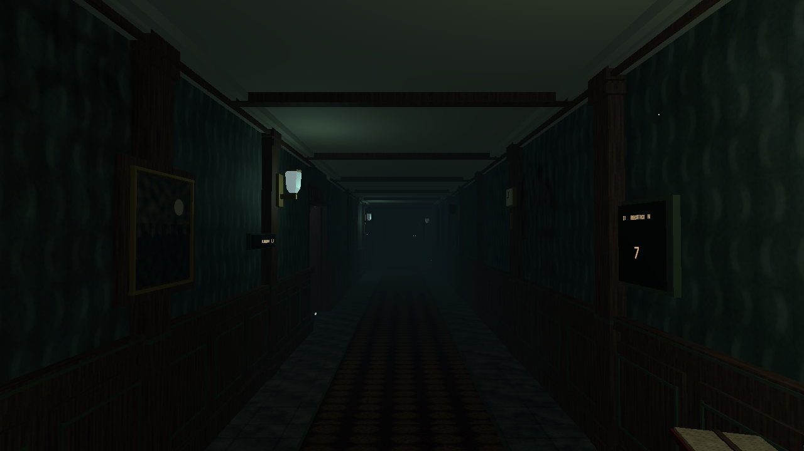

# Nightmare Update

La rama parte de Hotel Umbral en `e3242d3`. El trabajo usa el mismo repositorio desde un directorio Git separado para conservar las modificaciones locales de Unity del proyecto que se usó para jugar la versión anterior. Se actualizó la escena existente `GameScene` con `NightmareAuthoring.Upgrade` y se reutilizaron el elevador, la geometría modular, el rig XR, los interactuables y las escenas de resultado.

| Entrega | Qué cambia | Archivos principales |
| --- | --- | --- |
| 1. Oscuridad | Iluminación fría de menor alcance, dos lámparas averiadas de inicio, niebla, manchas, balizas bajas, habitaciones oscuras y zonas rojas. Las placas mantienen texto legible durante un corte. | `GameScene.unity`, `NightmareLighting.cs`, `NightmareStain.shader`, `Assets/HotelUmbral/Nightmare` |
| 2. Amenaza y tensión | Director con cinco estados e histéresis. La criatura entra en juego antes del primer sello, mantiene la persecución con NavMesh y acelera en embestidas cortas con señal sonora. | `HorrorTensionDirector.cs`, `Creature.cs`, `NightmareProfile.cs` |
| 3. Atmósfera y audio | Pasos y voces direccionales, golpes tras las paredes, lámparas que fallan, caída de cuadro, portazo, maleta desplazada, rotura y apariciones. El director elige por proximidad y fase, con pausas entre eventos. | `HorrorEventDirector.cs`, `JumpscareTrigger.cs`, `NightmareSound.cs`, `NightmareAuthoring.Events.cs`, `Nightmare/Sounds` |
| 4. Acertijo y salida | Los cuatro dígitos siguen en sus soportes. Mantener la vista en un sello próximo lo registra y dos sellos emiten ruido. El progreso y la estancia en las habitaciones incrementan la presión. Completar los sellos o empezar a teclear activa el clímax. | `GameCodeManager.cs`, `Keypad.cs`, `HorrorTensionDirector.cs`, `NightmareTelemetry.cs` |
| 5. Captura y dificultad | Preparación de ataque, avance del modelo, impacto, háptica y fundido. El modo de sustos suaves reduce cambios de luz y sonido. Normal, Pesadilla y Terror extremo se seleccionan en la cabina. | `CreatureAttackSequence.cs`, `HotelOptions.cs`, `NightmareProfile.cs` |

Se eligieron balizas fijas de baja intensidad y placas contrastadas para orientar al jugador con las manos libres. La niebla usa el renderizador URP existente. Las luces averiadas y la baliza de persecución se deshabilitan al apagarse para ahorrar ranuras de luces adicionales. Los tres perfiles reutilizan los límites de luces de URP y la misma ruta de colisiones. La criatura conserva tres oportunidades en cada perfil. Un repelido retrasa la próxima embestida y la criatura puede seguir acercándose a velocidad normal tras recuperarse.

## Jugar y editar

Abre el proyecto con Unity `6000.3.19f1`, carga `Assets/Scenes/GameScene.unity` y pulsa **Play** en el Editor. En la cabina pulsa el botón inferior para alternar el perfil. **Pesadilla** es el valor inicial. Pulsa **Play / Jugar** para comenzar la partida. En Windows sin visor usa WASD y ratón, pulsa E o clic izquierdo para interactuar, E para soltar y clic derecho para lanzar. Esc libera el cursor.

Los perfiles se editan en `Assets/HotelUmbral/Nightmare`. Los parámetros principales gobiernan velocidad, ráfagas, descanso, reacción, duración del repelido, demora por habitación, intervalo de eventos, luz, mezcla y ayudas escritas. `Nightmare Update` contiene los sistemas añadidos a la escena. El menú **Hotel Umbral → Apply Nightmare Update** reaplica la puesta en escena y regenera sus recursos. Guarda primero el trabajo de edición manual que quieras conservar. Si regeneras Hotel Umbral desde su comando original, aplica Nightmare después.

## Pruebas y mediciones

| Cámara de comparación | Hotel Umbral | Nightmare | Reducción |
| --- | ---: | ---: | ---: |
| Pasillo al salir | 50,35 | 16,20 | 67,8 % |
| Sello de la habitación 104 | 36,18 | 13,84 | 61,8 % |
| Persiana y teclado | 34,67 | 19,78 | 42,9 % |

Valores de luminancia de píxel codificada en sRGB de 0 a 255, muestreados cada cuatro píxeles en capturas Direct3D 11 con la misma cámara y resolución 1280×720. El número de la habitación y el teclado conservan contraste visual en las capturas. Los 13 WAV originales suman 27,1 s y su pico PCM es de 0,701 de la escala digital. Esa comprobación mide los archivos fuente.

| Hotel Umbral | Nightmare Update |
| --- | --- |
|  |  |

`HotelSmoke.Run` cubre las tres escenas, viaje, botones, agarre XRI simulado, las cinco roturas físicas, navegación, oclusión, las tres miradas, teclado, victoria, captura y reinicio. Incluye un recorrido adicional que mueve el CharacterController a velocidad de escritorio, registra los cuatro sellos mediante mirada y utiliza las defensas en el teclado. Las rutas son automatizadas y los resultados corresponden a esta máquina.

En el recorrido inicial la criatura capturó al jugador a los 30,0 s mientras tecleaba, con dos miradas aún disponibles. Ese ensayo motivó un intervalo mínimo antes de la siguiente embestida tras repelerla. La ruta posterior usó las miradas restantes en la salida y registró una victoria.

| Recorrido automatizado Pesadilla | Medición |
| --- | ---: |
| Duración de la victoria, desde Play | 35,7 s |
| Primer encuentro desde Play | 10,7 s |
| Primer encuentro desde la entrada al pasillo | 1,8 s |
| Persecuciones registradas | 5 |
| Sellos registrados y miradas consumidas | 4 y 3 |
| Tiempo dedicado al teclado | 4,7 s |

Los eventos observados incluyeron caída de cuadro, apagón y respiración detrás del jugador. La segunda victoria tomó 35,8 s y activó pasos detrás, apagón y rotura de vidrio. También pasó la prueba que cierra una puerta de habitación, bloquea la ruta NavMesh y verifica que puede reabrirse.

La telemetría se guarda como JSON en `Builds/NightmareTelemetry` en el Editor. En un ejecutable con `-nightmareTelemetry`, se guarda en `Application.persistentDataPath/NightmareTelemetry`. Cada sesión incluye duración desde Play, primer encuentro, persecuciones, tiempos entre sellos, miradas, tiempo desde la primera entrada en el teclado, desenlace y eventos. Los tiempos usan segundos del juego. Los archivos se quedan en disco local y registran índices de sellos y acciones del teclado.

```powershell
$unity = 'C:/Program Files/Unity/Hub/Editor/6000.3.19f1/Editor/Unity.exe'
$project = (Get-Location).Path
New-Item -ItemType Directory -Path Logs -Force | Out-Null
& $unity -batchmode --burst-disable-compilation -projectPath $project -executeMethod HotelSmoke.Run -logFile "$project/Logs/NightmareSmoke.log" | Out-Host
& $unity -batchmode -nographics -quit --burst-disable-compilation -projectPath $project -executeMethod HotelAuthoring.BuildWindows -logFile "$project/Logs/NightmareBuild.log" | Out-Host
```

La compilación Windows x64 con Mono terminó con cero avisos y se comprobó que el ejecutable arranca con Direct3D 11. Los registros de esta máquina están en `Logs/NightmareSmoke.log`, `Logs/NightmareBuild.log` y `Logs/NightmarePlayer.log`.

En la validación original, la máquina con RTX 3060 carecía de un runtime OpenXR activo. El sistema bloqueó una DLL de Burst JIT generada en este directorio, por lo que se usó el parámetro de batch para deshabilitar Burst en esa ejecución.

## Validación en visor

El rig heredaba un `Camera Offset` de 3,5 m y aceptaba el modo de seguimiento del runtime. El modo escritorio decidía en `Start` y desactivaba el seguimiento y la locomoción durante toda la escena si la pantalla XR aún estaba detenida. El menú y el teclado usan botones físicos con collider y `XRSimpleInteractable`. El gatillo estaba asociado a la activación, mientras que los botones solo escuchaban la selección por agarre o toque. Las dos modalidades de giro estaban habilitadas en el prefab. Las tres escenas tienen un solo `EventSystem` con `XRUIInputModule`.

`HotelXrSession` espera el primer seguimiento válido y centra horizontalmente la cabeza y la cápsula sobre el punto de aparición. Solicita `Floor` si el runtime lo admite. En modo `Device` aplica el campo **Device Eye Height** del rig, configurado a 1,62 m. El mismo origen mueve la cabeza y ambos mandos. El seguimiento `Floor` conserva la altura real del jugador sentado o de pie. El movimiento usa el joystick izquierdo a 1,75 m/s y la cápsula de XRI. El menú alterna entre 30° por paso y 55°/s en giro suave.

Para comprobar el simulador, añade temporalmente el prefab `XR Device Simulator.prefab` de `Assets/Samples/XR Interaction Toolkit/3.5.1/XR Device Simulator/` a `GameScene` y entra en Play Mode. La consola debe registrar `mode=Simulator` y los mandos simulados deben mover los rayos. Una sesión OpenXR activa desactiva el simulador.

`HotelSmoke.Run` pasó en Unity 6000.3.19f1. Verificó las referencias de las tres escenas, el prefab del simulador, las poses de ambos mandos, audio, dificultad, giro, selección de **PLAY / JUGAR** con el gatillo, colisión con las puertas cerradas y salida con el joystick. También pasó el recorrido completo de Nightmare, incluida la captura, la victoria y los reinicios. El registro local es `Logs/HotelXrSmoke.log`.

La compilación Windows x64 terminó con cero avisos y arrancó con Direct3D 11. Los registros locales son `Logs/HotelXrBuild.log` y `Logs/HotelXrPlayer.log`. El runtime OpenXR cargó, con los subsistemas de pantalla y entrada detenidos y sin dispositivos físicos disponibles para la prueba.

En un visor físico queda pendiente este recorrido.

1. Calibra el suelo del visor y activa su runtime OpenXR. Para PC VR, conecta el visor y enciende ambos mandos antes de arrancar el ejecutable o entrar en Play Mode.
2. De pie, comprueba que apareces dentro de la cabina mirando al panel. Agáchate, desplázate un paso y vuelve a tu posición. Repite sentado y registra si el suelo, el panel y el movimiento se perciben a la altura esperada.
3. Apunta con cada mando y pulsa el gatillo sobre audio, dificultad y giro. Pulsa **PLAY / JUGAR** y prueba el joystick izquierdo contra las puertas cerradas. Cruza al abrirse y verifica el giro por pasos, el giro suave y el teletransporte.
4. Abre una puerta lateral, agarra y rompe un objeto, lee los cuatro sellos e introduce el código. Comprueba la victoria y el reinicio. En otra partida, comprueba la captura y el retorno a la cabina.
5. Guarda las líneas `[Hotel XR]` del Editor o de `Player.log`. Registra el modelo de visor y mandos, el runtime, `display`, `input`, el modo de seguimiento, `eyeHeight` y el estado de los tres dispositivos. Si aparece `Device`, comprueba que la altura corresponde al ajuste del rig. Anota el paso exacto si falla algo.
